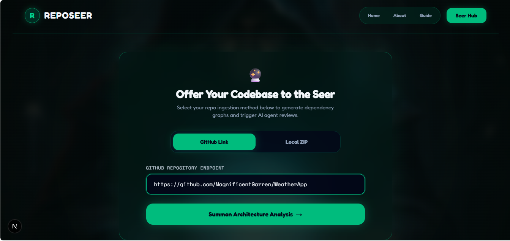
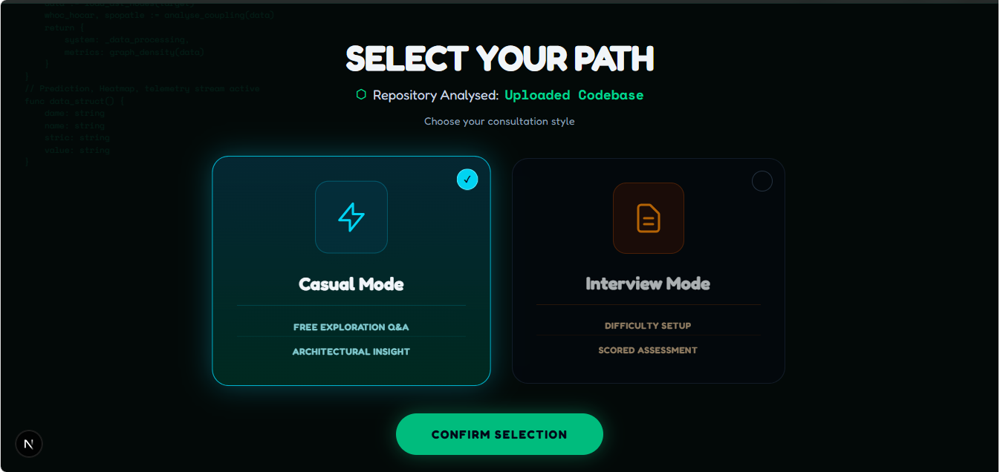
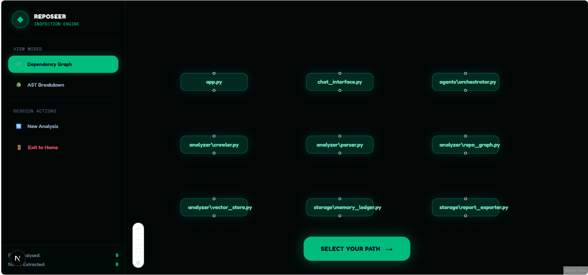
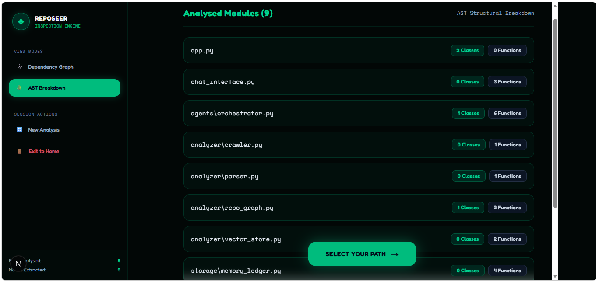
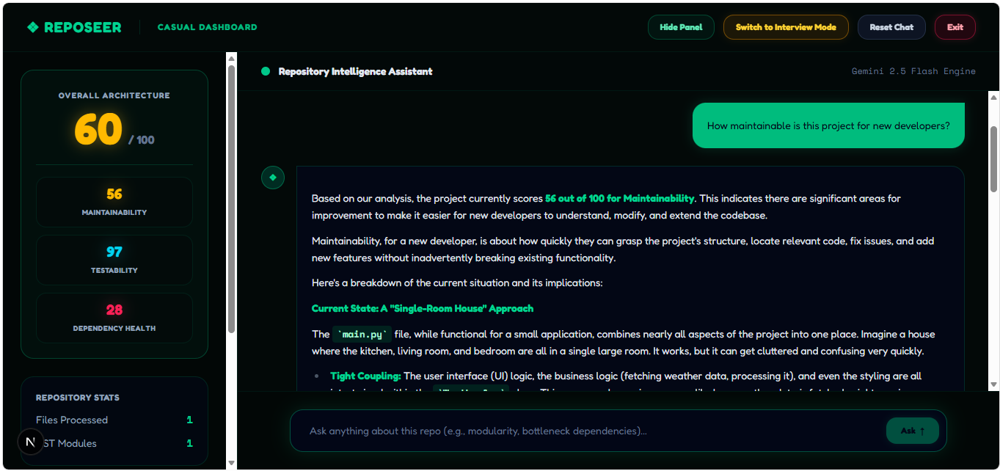
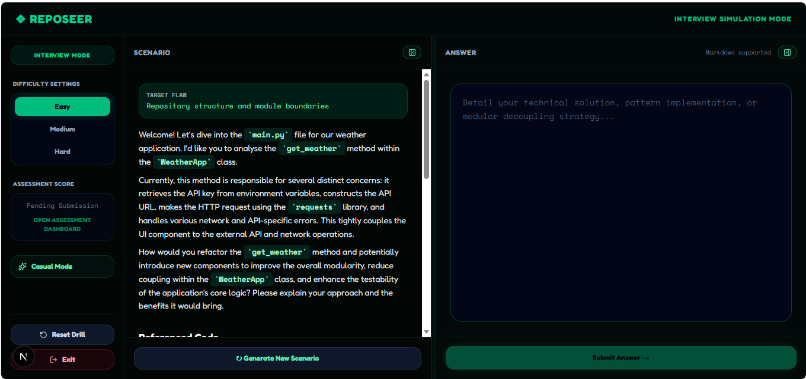
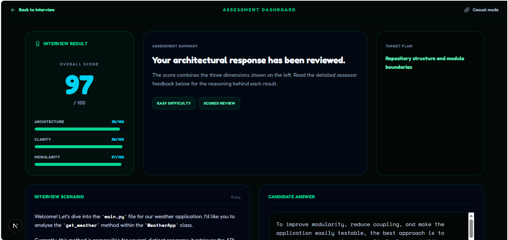
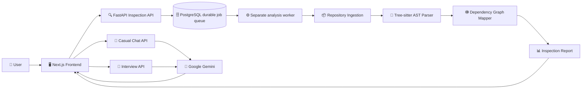

# 🔭 Reposeer

### AI-Powered Repository Intelligence & Architectural Interview Simulator

> **Don't just read the codebase. Understand it. Challenge it. Defend it.**

Reposeer is an AI-assisted developer tool designed to turn unfamiliar Python repositories into something you can actually **understand, explore, and reason about**.

It combines **static code analysis, AST parsing, dependency mapping, repository inspection, AI-powered conversation, and architectural interview simulation** into one platform.

Whether you're trying to understand a new codebase, investigate its architecture, or test whether you can explain your own engineering decisions under pressure — **Reposeer is built to make you think like a technical lead.** 🧠

---

## 🚀 What is Reposeer?

Walking into an unfamiliar repository can feel like this:

```text
src/
├── utils/
├── services/
├── core/
├── manager/
├── helper_final.py
├── helper_final_v2.py
└── somehow_this_works.py
```

You open one file.

Then another.

Then another.

Three hours later, you're still trying to figure out who calls what.

**Reposeer exists to fix that.**

It analyses a Python repository and builds a structured understanding of its:

* 🧩 Modules and dependencies
* 🌳 Abstract Syntax Tree (AST) structure
* 🏗️ Classes and functions
* 🔗 Import relationships
* 🕸️ Dependency graphs
* ⚠️ Architectural risks
* 💬 AI-assisted explanations
* 🎯 Interview scenarios
* 📊 Architectural evaluation

Instead of simply asking:

> *"What does this code do?"*

Reposeer helps you ask:

> *"Why is it designed this way, what could go wrong, and how would I explain it in an architecture interview?"*

---

# ✨ Features

| Feature                        | Description                                              |
| ------------------------------ | -------------------------------------------------------- |
| 🐙 **GitHub Analysis**         | Analyse public GitHub repositories                       |
| 🔐 **Account Dashboard**       | Review plan usage, saved repositories, and reports       |
| 🎨 **Theme Preferences**       | Choose system-default, light, or dark appearance          |
| 🌳 **AST Analysis**            | Inspect classes, functions and imports                   |
| 🕸️ **Dependency Graphs**      | Visualise relationships between modules                  |
| 🤖 **AI Repository Chat**      | Ask questions about the analysed codebase                |
| 🎯 **Interview Mode**          | Practise repository-aware architecture interviews        |
| ⚡ **Live Analysis**            | Stream analysis progress to the frontend                 |
| 📊 **Evaluation Metrics**      | Receive structured feedback on interview responses       |
| 🧠 **Architectural Reasoning** | Explore maintainability, modularity and design decisions |

---

# 🖥️ Product Walkthrough

## 01 — 🔌 Connect a Repository

Sign in, then provide a **public GitHub repository URL** containing at least one Python source file.

Reposeer takes the repository and begins building an understanding of the codebase.



---

## 02 — 🧭 Choose Your Mode

Once the repository has been analysed, you can choose how you want to interact with it.

### 💬 Casual Mode

Explore the repository conversationally.

Ask questions about:

* Architecture
* Dependencies
* Maintainability
* Modularity
* Potential risks
* Code organisation

### 🎯 Interview Mode

Stop asking questions.

Start answering them.

Interview Mode generates repository-aware architectural scenarios and challenges you to explain your engineering decisions.



---

# 🕸️ Repository Intelligence

## Dependency Graph

Reposeer transforms repository relationships into a visual dependency graph.

You can inspect:

* Module relationships
* Import paths
* Dependency clusters
* Potential circular dependencies
* Structural relationships within the repository



---

## 🌳 AST Breakdown

Reposeer uses **Tree-sitter** to inspect Python source structure.

Instead of treating source code as a wall of text, the system identifies important structural elements such as:

```text
Python File
   │
   ├── Imports
   │
   ├── Classes
   │    ├── Methods
   │    └── Attributes
   │
   └── Functions
```

This provides the structural foundation for the repository analysis.



---

# 🤖 Meet the Seer

Once the repository has been analysed, the AI can use the generated inspection information as context.

Ask questions like:

> "Where is authentication handled?"

> "What are the major dependencies in this project?"

> "Where could this architecture become difficult to maintain?"

> "How would you restructure this module?"

> "What would you ask a developer about this codebase in an interview?"



The goal isn't simply to generate answers.

It's to help developers **understand the reasoning behind the code.**

---

# 🎯 Architecture Interview Mode

This is where things get uncomfortable.

In a good way.

Interview Mode generates architectural scenarios based on the analysed repository.

Choose your difficulty:

```text
🟢 EASY
Understand the architecture.

🟡 MEDIUM
Explain the architecture and identify trade-offs.

🔴 HARD
Defend your architectural decisions.
```

You are given a scenario and expected to provide an architectural response.



---

# 🧠 Architectural Evaluation

After submitting your response, Reposeer evaluates the answer and provides structured feedback.

The evaluation focuses on areas such as:

* 🏗️ Architecture
* 💬 Clarity
* 🧩 Modularity
* 🔍 Technical reasoning
* 📚 Understanding of the repository

The purpose isn't just to produce a number.

The goal is to answer:

> **"Why did I receive this evaluation?"**



---

# 🏗️ Architecture



### 🔄 Analysis Pipeline

```text
Repository
     │
     ▼
📥 Ingestion
     │
     ▼
🌳 AST Parsing
     │
     ▼
🔗 Dependency Mapping
     │
     ▼
📊 Structural Analysis
     │
     ▼
🧠 Repository Context
     │
     ├───────────────┐
     ▼               ▼
💬 Casual Mode   🎯 Interview Mode
     │               │
     └───────┬───────┘
             ▼
        🤖 AI Feedback
```

---

# 🛠️ Technology Stack

## 🎨 Frontend

* **Next.js 16**
* **React 19**
* **TypeScript**
* **Tailwind CSS**
* **React Flow**
* **React Markdown**
* **Lucide React**

## ⚙️ Backend

* **Python 3.11+**
* **FastAPI**
* **Uvicorn**
* **Tree-sitter**
* **Tree-sitter Python**
* **GitPython**
* **NetworkX**
* **Pydantic**
* **Google Gemini**

## 🗄️ Infrastructure

* **Docker Compose**

---

# 📁 Project Structure

```text
reposeer/
│
├── backend/
│   ├── app/
│   │   ├── api/
│   │   │   ├── chat.py
│   │   │   ├── inspect.py
│   │   │   └── interview.py
│   │   │
│   │   ├── models/
│   │   │
│   │   └── services/
│   │       ├── ast_parser.py
│   │       ├── graph_mapper.py
│   │       └── ingestion.py
│   │
│   ├── Dockerfile
│   ├── pyproject.toml
│   └── requirements.txt
│
├── frontend/
│   ├── public/
│   │   └── guide/
│   │
│   ├── src/
│   │   ├── app/
│   │   ├── components/
│   │   └── lib/
│   │
│   ├── Dockerfile
│   └── package.json
│
├── docker-compose.yml
└── README.md
```

---

# ⚡ Getting Started

## 📋 Requirements

Before running Reposeer locally, make sure you have:

* **Node.js 20+**
* **npm 10+**
* **Python 3.11+**
* **Git**
* **Docker Desktop** *(recommended)*
* A **Google Gemini API key** for AI functionality

---

# 🔐 Environment Variables

Copy the example configuration to `.env` in the repository root:

```powershell
Copy-Item .env.example .env
```

Set the Supabase project URL and public anon key in both the server-only and `NEXT_PUBLIC_` settings below. Google sign-in also requires the dashboard configuration described in [Google and Supabase OAuth setup](#-google-and-supabase-oauth-setup). Set `GEMINI_API_KEY` for chat and interview AI. `NEXT_PUBLIC_API_URL` is the URL the user's browser can reach; it is embedded in the frontend image at build time. Set `REPOSEER_CORS_ORIGINS` to a comma-separated allowlist of frontend origins. Docker Compose starts PostgreSQL locally; for a hosted deployment, set `DATABASE_URL` to the private PostgreSQL connection string in the backend dashboard.

| Setting | Purpose | Default |
| --- | --- | --- |
| `GEMINI_API_KEY` | Google Gemini key for chat and interview features | unset |
| `SUPABASE_URL` | Supabase project URL used by the backend to verify access tokens | unset |
| `SUPABASE_ANON_KEY` | Supabase public anon key sent to the Auth user-verification endpoint | unset |
| `DATABASE_URL` | PostgreSQL connection string used for reports, durable queued jobs, and usage data; the API and worker must use the same database | Compose local database |
| `REPOSEER_RATE_LIMIT_HMAC_KEY` | Optional stable secret for hashing client IPs in usage records; defaults to a key derived from `DATABASE_URL` | derived |
| `POSTGRES_DB`, `POSTGRES_USER`, `POSTGRES_PASSWORD` | Local Compose database settings only; choose a strong local password | local defaults |
| `NEXT_PUBLIC_SUPABASE_URL` | Supabase URL used by the frontend auth client | unset |
| `NEXT_PUBLIC_SUPABASE_ANON_KEY` | Supabase public anon key used by the frontend auth client; safe to expose | unset |
| `NEXT_PUBLIC_API_URL` | Browser-visible backend URL; requires rebuilding the frontend image when changed | `http://localhost:8000` |
| `REPOSEER_CORS_ORIGINS` | Comma-separated exact frontend origins allowed by the backend | local frontend origins |
| `REPOSEER_MAX_ARCHIVE_SIZE_MB` | Maximum size for legacy ZIP jobs already in the durable queue | `25` |
| `REPOSEER_MAX_EXTRACTED_SIZE_MB` | Maximum expanded size for legacy queued ZIP jobs | `100` |
| `REPOSEER_MAX_ARCHIVE_FILES` | Maximum file count for legacy queued ZIP jobs | `2000` |
| `REPOSEER_REPORT_RETENTION_DAYS` | Report retention period; expired reports are deleted automatically | `7` |
| `REPOSEER_ANALYSIS_STALE_SECONDS` | Time without reported job progress before recovery is allowed | `300` |

The Free plan currently allows **3 analyses per day and 20 per month per account**, **1 concurrent analysis**, and **10 AI actions per day and 100 per month per account**. Shared IP limits are **10 analyses per day and 100 per month**, plus **30 AI actions per day and 300 per month**. The signed-in dashboard displays account usage and reset times; a chat message, interview question, or evaluation consumes one AI action. Paid and Premium checkout is not available yet. The subscription screen displays proposed pricing of **$12/month or $120/year** for Paid and **$29/month or $290/year** for Premium, with higher proposed usage limits; these prices and paid limits are not active or enforced until launch. ZIP uploads have been retired; existing queued ZIP work remains processable while the legacy worker path is retained.

Analysis jobs are inserted into PostgreSQL with their source information in the same transaction as the quota reservation. Each running API instance also runs a queue polling loop in its backend process; it claims jobs using PostgreSQL row locks and renewable leases. This co-located worker avoids requiring a separately billed service. Interrupted jobs become claimable again after the lease expires, with up to three processing attempts. Legacy ZIP bytes are stored in the job row until the job completes or fails, then cleared. Workers clone repositories into temporary folders, which are removed when work ends and swept if older than 24 hours. There is no Redis requirement: PostgreSQL is both the durable job queue and the database for reports and usage data.

The API reads progress from PostgreSQL, so any API instance can report progress for work handled by any instance. The browser reconnects by polling the saved job state and retries temporary network/API errors with a bounded backoff. The SSE endpoint is also available for clients that prefer streaming. If an instance stops updating a job, its lease expires and another running instance can retry it. Signed-in users can reconnect to their active analysis from Seer Hub after a refresh or dropped connection. The recovery action requeues a stale job instead of discarding it. Reports, including repository excerpts used for the AI context, are private to the verified account and retained for 7 days by default. Users can review and delete their saved reports from **Seer Hub → View saved reports**. Usage records keep account IDs and keyed IP hashes for up to 13 months for quota enforcement and operational monitoring.

### Deploying durable analysis jobs on Render

The local Compose stack starts PostgreSQL, the API (including its queue polling loop), and the frontend. For the existing Render backend service:

1. Keep using the existing Render web service. Deploy the backend changes to its current branch; startup launches the API and its queue poller together. Do **not** create a separate Render worker service.
2. Confirm that the backend's `DATABASE_URL` points to a persistent PostgreSQL database and that the backend can reach it. The startup migration needs permission to alter the schema. Back up the database; jobs and reports are only as durable as this database.
3. Keep the existing API start command and runtime settings. The queue poller starts automatically when the app connects to PostgreSQL. The worker uses the same service environment, including GitHub outbound HTTPS access for public repository clones.
4. Monitor backend logs for the `Analysis worker ... started` message, job processing errors, and database connectivity. The service must be running to process jobs.
5. Test an API restart during analysis. The job remains queued/processing in PostgreSQL and can be reclaimed after its lease expires. If the Render instance sleeps or is stopped, analysis pauses until the service runs again; it is not lost.
6. This is a cost-saving compromise, not full worker/API isolation: analysis uses the same CPU and memory as API requests. If Render runs multiple backend instances, each will poll the same queue and PostgreSQL will coordinate job claims.
7. Keep a database backup and test restoration. The queue and reports are only as durable as PostgreSQL.

No separate worker service, Redis, object-storage bucket, shared temporary filesystem, or worker-facing HTTP route is required by this configuration.

⚠️ **Never commit API keys, credentials, or other secrets to GitHub.**

---

# 🔑 Google and Supabase OAuth Setup

The browser signs in with Google through Supabase Auth. The backend verifies each bearer token with Supabase Auth and uses the returned user ID; browser-supplied user IDs are never trusted. Keep the Supabase **service-role** key out of the frontend and out of these environment variables.

1. **Create or select a Supabase project.** In the Supabase dashboard, open **Project Settings → API** and copy the project URL and the public `anon` key. Do not copy the `service_role` secret.
2. **Create a Google OAuth client.** In Google Cloud Console, select a project, complete the OAuth consent-screen configuration, and create an OAuth client ID with application type **Web application**.
3. **Copy Supabase's provider callback URL.** In Supabase, open **Authentication → Sign In / Providers → Google**. Copy the callback URL shown on that page. It has this form, using your project's actual reference:

   ```text
   https://<project-ref>.supabase.co/auth/v1/callback
   ```

4. **Register the callback with Google.** Add that exact URL to the Google OAuth client's **Authorised redirect URIs**. Do not use the frontend's `/auth/callback` URL here; Google returns to Supabase first.
5. **Enable Google in Supabase.** Turn on the Google provider and paste the Google OAuth client ID and client secret into the Supabase provider form. Save the provider settings.
6. **Allow the frontend return URLs in Supabase.** In **Authentication → URL Configuration**, set the Site URL to the deployed app's canonical origin and add every app callback URL to **Redirect URLs**. Examples:

   ```text
   http://localhost:3000/auth/callback
   http://localhost:3001/auth/callback
   https://staging.example.com/auth/callback
   https://app.example.com/auth/callback
   ```

   Replace the staging and production examples with the real origins. Include only environments you control.
7. **Set local configuration.** In the repository root `.env`, set `SUPABASE_URL` and `SUPABASE_ANON_KEY` for the backend. Set `NEXT_PUBLIC_SUPABASE_URL`, `NEXT_PUBLIC_SUPABASE_ANON_KEY`, and `NEXT_PUBLIC_API_URL=http://localhost:8000` for the frontend. Docker Compose starts PostgreSQL and applies checked-in migrations automatically; leave `DATABASE_URL` blank to use that local service. Docker Compose passes the frontend settings into the build. When running Next.js directly from `frontend`, also create `frontend/.env.local` with those three `NEXT_PUBLIC_` settings because Next.js loads environment files from the frontend project directory. Allow both development origins in the backend with `REPOSEER_CORS_ORIGINS=http://localhost:3000,http://localhost:3001`.
8. **Set deployed configuration.** In the backend deployment, set `SUPABASE_URL`, `SUPABASE_ANON_KEY`, and a private PostgreSQL `DATABASE_URL` with TLS enabled. Use a dedicated `REPOSEER_RATE_LIMIT_HMAC_KEY` so IP-rate hashes remain stable if the database password rotates. In the frontend build environment, set `NEXT_PUBLIC_SUPABASE_URL`, `NEXT_PUBLIC_SUPABASE_ANON_KEY`, and `NEXT_PUBLIC_API_URL`. Configure `REPOSEER_CORS_ORIGINS` on the backend to include the exact frontend origin (scheme, host, and port; no path or wildcard). Rebuild the frontend after changing `NEXT_PUBLIC_` values. The backend applies pending migrations at startup; do not expose the database administrative credentials to the browser.
9. **Configure Google's consent screen.** Supply the app name, support email, developer contact, and requested scopes (`openid`, `email`, and `profile` are sufficient for this sign-in). Add a homepage, privacy policy, and terms URL if Google requires them for the selected publishing status. While the consent screen is in testing, add each test user's Google account to the test-user list. Move the app to production when ready; Google may require domain verification or OAuth verification depending on the scopes and usage.
10. **Confirm retention and privacy wording.** Before inviting users, confirm whether the 7-day report retention is acceptable and publish privacy-notice text explaining that report data (including repository excerpts) and quota/usage records are stored server-side. The current backend default is 7 days; change `REPOSEER_REPORT_RETENTION_DAYS` only after deciding and updating the notice.
11. **Restart and verify.** Run `docker compose up --build` (or restart the local frontend and backend). Open the site, choose **Sign in with Google**, complete the Google consent flow, and return to the app. Start an analysis and try chat or interview mode. Confirm that your report appears under **View saved reports**, can be reopened and deleted, and that another account cannot read it. A signed-out request or invalid/expired token should receive HTTP 401; the analysis progress stream is visible only to the account that started it.

The public home, About, and Guide pages remain available without signing in. Analysis jobs, reports, and usage records are stored in PostgreSQL. Browser session storage continues to hold the active report copy and conversational UI state; it is not the durable report store.

---

# 🐳 Run with Docker

The Compose configuration builds the frontend and backend and starts PostgreSQL for durable jobs, reports, and usage data. Redis is not currently used.

After configuring `.env`, build and start both services:

```bash
docker compose up --build
```

Then open:

```text
http://localhost:3001
```

### Backend

```text
http://localhost:8000
```

### FastAPI Documentation

```text
http://localhost:8000/docs
```

### Health checks

The backend responds at `http://localhost:8000/health`. Compose waits for the backend health check before starting the frontend and reports health for both services.

The backend persists inspection job metadata in PostgreSQL, but analysis workers are scheduled in process memory. Run one backend worker and a single backend replica; use a persistent job queue before scaling horizontally. For deployment behind a reverse proxy, allow the backend's 1 MB request body limit and preserve long-lived responses from `/api/inspect/stream/` and `/api/seer/chat`.

### Stop the application

```bash
docker compose down
```

---

# 💻 Run Locally

## ⚙️ Backend

From the repository root:

```bash
cd backend
```

Create a virtual environment:

```bash
python -m venv .venv
```

### Windows

```powershell
.\.venv\Scripts\Activate.ps1
```

### macOS / Linux

```bash
source .venv/bin/activate
```

Install dependencies:

```bash
pip install -r requirements.txt
```

Start FastAPI:

```bash
uvicorn app.main:app --reload --port 8000
```

---

## 🎨 Frontend

Open another terminal:

```bash
cd frontend
```

Install dependencies:

```bash
npm install
```

Start the development server:

```bash
npm run dev
```

Open:

```text
http://localhost:3000
```

---

# 🔌 API

| Method | Endpoint                           | Purpose                             |
| ------ | ---------------------------------- | ----------------------------------- |
| `GET`  | `/`                                | Backend health response             |
| `GET`  | `/health`                          | Container health check               |
| `POST` | `/api/inspect/github`              | Analyse a public GitHub repository (bearer token required) |
| `GET`  | `/api/inspect/usage`               | Return the authenticated account's plan usage and reset times |
| `GET`  | `/api/inspect/repositories`        | List saved GitHub repositories |
| `POST` | `/api/inspect/repositories`        | Save a GitHub repository |
| `DELETE` | `/api/inspect/repositories/{id}` | Remove a saved repository |
| `GET`  | `/api/inspect/preferences`         | Read the account appearance preference |
| `PUT`  | `/api/inspect/preferences`         | Save the account appearance preference |
| `GET`  | `/api/inspect/stream/{job_id}`     | Stream progress for the verified job owner |
| `POST` | `/api/seer/chat`                   | AI-assisted repository conversation (bearer token required) |
| `POST` | `/api/interview/generate-question` | Generate an interview scenario (bearer token required) |
| `POST` | `/api/interview/evaluate`          | Evaluate an interview response (bearer token required) |

Protected API calls require `Authorization: Bearer <Supabase access token>`. The backend verifies the token with Supabase Auth and uses the returned user ID.

### Example

Start a repository inspection:

```bash
curl -X POST http://localhost:8000/api/inspect/github \
  -H "Authorization: Bearer <supabase-access-token>" \
  -H "Content-Type: application/json" \
  -d "{\"repo_url\":\"https://github.com/owner/repository\"}"
```

The API returns a job identifier:

```json
{
  "job_id": "job-identifier",
  "status": "processing"
}
```

Use the identifier to stream analysis progress:

```bash
curl http://localhost:8000/api/inspect/stream/job-identifier \
  -H "Authorization: Bearer <supabase-access-token>"
```

---

# 🔬 How Analysis Works

Reposeer's inspection pipeline follows these stages:

```text
1. 🔗 Validate repository source
          ↓
2. 📥 Clone / extract repository
          ↓
3. 🐍 Collect Python source files
          ↓
4. 🌳 Parse source using Tree-sitter
          ↓
5. 🕸️ Build dependency graph
          ↓
6. 📊 Calculate structural metrics
          ↓
7. 📋 Generate inspection report
          ↓
8. 🧠 Provide context to AI features
```

This allows the AI-powered features to work with information derived from the repository rather than relying purely on a generic conversation.

---

# 🧪 Testing

### Backend Tests

From the `backend` directory:

```bash
pytest
```

The backend tests cover Supabase bearer-token validation, quota rejection, analysis/report ownership, retired ZIP ingestion, saved repositories and preferences, job progress and failure states, chat/interview flows, and checks that provider failures do not expose credentials or source code in logs. AI-provider calls are mocked; staging behavior still needs to be verified against the deployed services.

### Frontend Linting

```bash
cd frontend
npm run lint
```

### Production Build

```bash
npm run build
```

---

# 🔒 Security

Some important considerations when running Reposeer:

* 🔑 Never commit `.env` files or API keys.
* 🐍 Repository analysis requires at least one Python source file and currently supports public GitHub repositories only.
* 🧠 Analysis jobs are currently stored temporarily in memory.
* 🐙 GitHub ingestion currently supports public repositories.
* 🌐 Configure `REPOSEER_CORS_ORIGINS` for the deployed frontend origin; wildcard origins are rejected.
* 🔐 Protected API routes verify Supabase bearer tokens and analysis jobs are scoped to their verified owner. Rate limiting is not included.

---

# 🚧 Current Limitations

Reposeer is actively evolving.

Current limitations include:

* GitHub analysis currently targets public repositories.
* Static analysis primarily focuses on Python.
* Analysis job state is held in memory and expires; reports are not synced across devices or stored in user accounts.
* AI functionality requires a configured Gemini API key.
* Rate limiting is not included.

---

# 🗺️ Roadmap

Reposeer is being built toward a more complete repository intelligence platform.

### 🔭 Planned

* [ ] 🔐 Private GitHub repository support
* [ ] 💾 Persistent analysis history
* [ ] 🌎 Additional programming language parsers
* [ ] 👤 Authentication and workspace support
* [ ] ⚡ Background task queue integration
* [ ] 📊 More detailed architecture metrics
* [ ] 📄 Exportable inspection reports
* [ ] ☁️ Production deployment templates

---

# 📜 License

This project is currently **unlicensed**.

A license should be added before distributing the project or accepting external contributions.

---

# 🙏 Acknowledgements

Reposeer would not exist without the excellent tools and technologies it builds upon.

* [Next.js](https://nextjs.org/)
* [FastAPI](https://fastapi.tiangolo.com/)
* [Tree-sitter](https://tree-sitter.github.io/tree-sitter/)
* [React Flow](https://reactflow.dev/)
* [NetworkX](https://networkx.org/)
* [Google Gemini](https://ai.google.dev/)

---

# 🧠 The Philosophy

Reposeer is built around a simple idea:

> **Understanding a codebase is an engineering skill.**

Reading code is easy.

Understanding why it exists is harder.

Explaining its architecture is harder still.

And defending that architecture when someone asks:

> *"Okay... but what happens when this system has 10 million users?"*

...is where things get interesting. 😅

Reposeer is designed to help developers get better at that last part.

---

# 🫡 Final Words

Built with **Python, TypeScript, FastAPI, Next.js, Tree-sitter, Gemini, questionable amounts of caffeine, and an unhealthy willingness to stare at dependency graphs.**

If Reposeer tells you that your architecture has a circular dependency...

**don't shoot the messenger.**

The messenger is just very good at finding your problems. 🔭

---

<p align="center">

### 🔭 Reposeer

**Inspect. Understand. Explain. Defend.**

</p>
